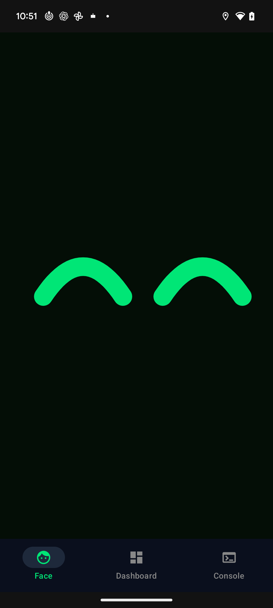
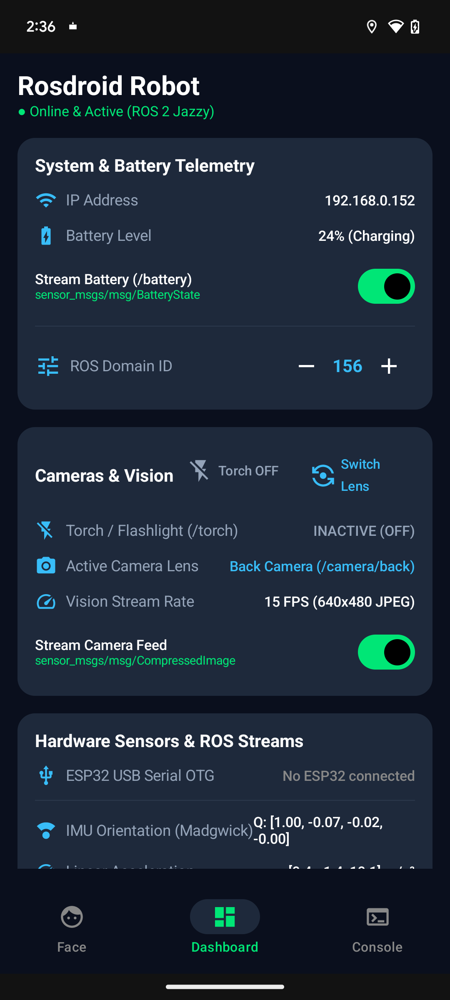
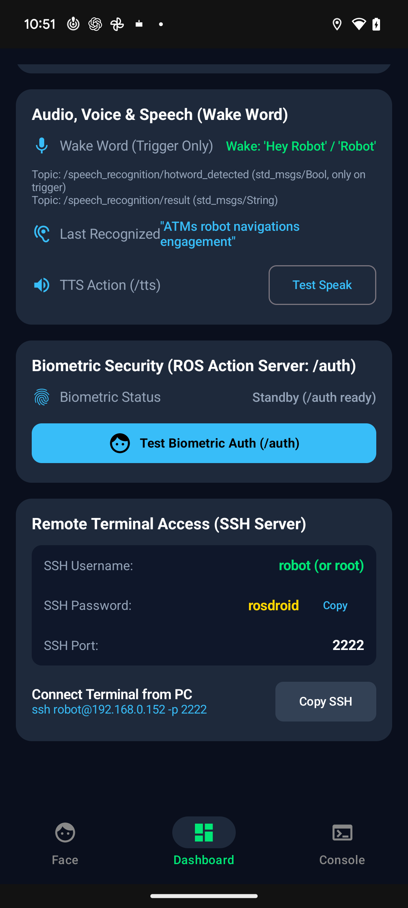
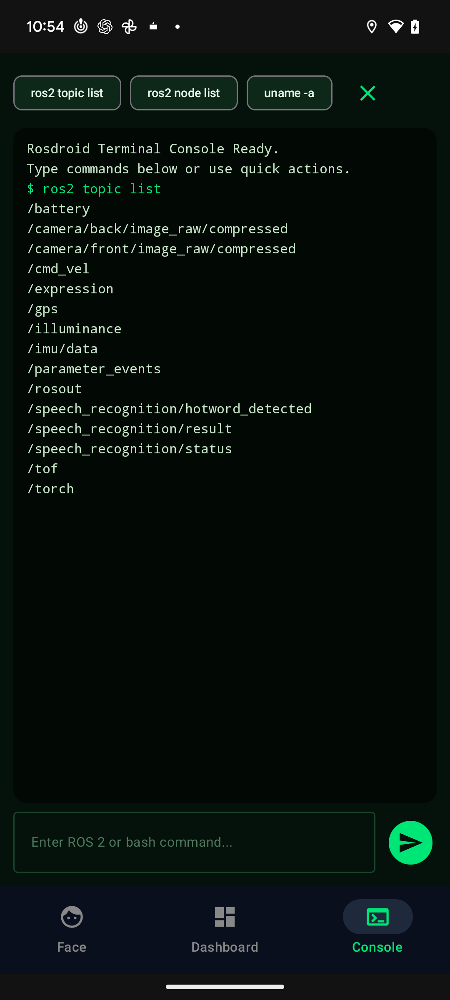

<div align="center">

[](https://docs.ros.org/en/jazzy/)
[](https://ubuntu.com/)
[](https://arm.com)
[](#-why-headless-server)
[](https://github.com/botforge-robotics/ros2_android/releases)
[](LICENSE)
[](https://github.com/botforge-robotics/ros2_android/actions/workflows/ci.yml)

# 🤖 Rosdroid: Headless ROS 2 Android Robot Platform

*Transform any standard Android smartphone into a high-performance, power-efficient robotics companion computer running a headless Ubuntu 24.04 Server, ROS 2 Jazzy Jalisco, Dropbear SSH, Micro-ROS, and a real-time sensor hub.*

[**Explore Documentation**](DEVELOPER.md) • [**Contributing Guide**](CONTRIBUTING.md) • [**Code of Conduct**](CODE_OF_CONDUCT.md) • [**Report Bug**](.github/ISSUE_TEMPLATE/bug_report.md)
</div>

---

## 📑 Table of Contents

- [Overview](#-overview)
- [What Rosdroid Replaces](#-what-rosdroid-replaces)
- [App Live Screenshots](#-app-live-screenshots)
- [Why Headless Server?](#-why-headless-server)
- [Architecture & Interfaces](#-architecture--interfaces)
- [Quick Start](#-quick-start)
- [Remote Terminal Access](#-remote-terminal-access)
  - [SSH Access (Ports 2222 & 2224)](#-ssh-access-ports-2222--2224)
  - [In-App Neon Green Terminal Console](#-in-app-neon-green-terminal-console)
- [ROS 2 Communication & PC Integration](#-ros-2-communication--pc-integration)
  - [1-Step PC Setup (`source_pc.sh`)](#1-step-pc-setup-source_pcsh)
  - [Available Topics & Sensors](#available-topics--sensors)
  - [Controlling Hardware over ROS 2](#controlling-hardware-over-ros-2)
- [USB OTG Micro-ROS Bridge](#-usb-otg-micro-ros-bridge)
- [Developer Guide & Community](#-developer-guide--community)
- [Troubleshooting & FAQs](#-troubleshooting--faqs)
- [License](#-license)

---

## 🌟 Overview

Rosdroid turns standard Android smartphones (`arm64-v8a`) into an all-in-one robotics brain, replacing a Raspberry Pi 5 + IMU/camera breakout boards + battery power bank + display + LTE/Wi-Fi modem.

- **Zero Root Required**: Uses a lightweight sandboxed **PRoot** guest filesystem.
- **Headless Ubuntu Server 24.04 (Noble)**: Pure server configuration without graphical desktop bloat for maximum performance and stability.
- **ROS 2 Jazzy Jalisco**: Pre-configured with **Eclipse Cyclone DDS** (`rmw_cyclonedds_cpp`) and custom `patch_getifaddrs.so`.
- **Fast Remote Access**: Multi-port Dropbear SSH (`robot:rosdroid` on port 2222, `root:rosdroid` on port 2224) plus an in-app interactive terminal console.
- **Rich Hardware Sensor Hub**: Dual cameras (hardware JPEG compression), 9-DOF IMU fused with a native C++ Madgwick AHRS filter, physical torch LED control, battery telemetry, GPS, ambient light, and speech recognition.
- **USB OTG Micro-ROS Bridge**: Plug-and-play serial relay for ESP32, Teensy, and STM32 motor controllers to `micro_ros_agent`.

---

## 💡 What Rosdroid Replaces

By installing Rosdroid on an Android phone, you eliminate hundreds of dollars in external hardware modules:

| Expensive External Hardware | Replaced By Built-in Phone Feature | ROS 2 Output Topic |
|---|---|---|
| **Single Board Computer** *(Raspberry Pi 5 / Jetson, $80-$150)* | **Octa-Core ARM64 CPU + PRoot Ubuntu 24.04** | Core ROS 2 Node (`/rosdroid_robot`) |
| **Dual Camera Modules** *(Pi Cam V3 / Webcams, $50-$80)* | **High-Res Front & Back Cameras (Hardware JPEG)** | `/camera/front/image_raw/compressed`<br>`/camera/back/image_raw/compressed` |
| **9-DOF IMU Breakout** *(BNO055 / MPU6050, $15-$35)* | **Built-in IMU fused with Native C++ Madgwick** | `/imu/data` *(quaternion orientation & rates)* |
| **Power Bank / UPS Battery Hat** *($30-$50)* | **Built-in 4000-5000 mAh Li-Po Battery + BMS** | `/battery` *(voltage, %, charge status)* |
| **Robot Display / OLED Screen** *($30-$60)* | **AMOLED Touch Display (Animated Cyber Eyes)** | `/expression` *(happy, thinking, alert, etc.)* |
| **External Robot Spotlight / LED** *($10)* | **High-Lumen Camera LED Flash Torch** | `/torch` *(hardware toggle on/off)* |
| **GPS / GNSS Receiver** *(NEO-6M, $20)* | **Built-in Multi-Constellation GPS Receiver** | `/gps` *(`sensor_msgs/NavSatFix`)* |
| **Ambient Light Sensor** *(BH1750, $8)* | **Built-in Ambient Light Sensor** | `/illuminance` *(`sensor_msgs/Illuminance`)* |
| **ToF / Ultrasonic Distance Sensor** *(HC-SR04, $8)* | **Built-in Time-of-Flight / Proximity Sensor** | `/tof` *(`sensor_msgs/Range`)* |
| **Microphone Array & Speaker** *($25)* | **Stereo Microphones & Loudspeaker** | Speech-to-Text, Wake Word, TTS |
| **Wi-Fi 6 & 4G/5G LTE Hat** *($60)* | **Built-in Wi-Fi & Cellular Modem** | Native ROS 2 Cyclone DDS over Wi-Fi |
| **USB Serial Converter** *($10)* | **USB-C OTG Micro-ROS Bridge** | Relays ESP32/STM32 serial to UDP 8888 |

---

## 📱 App Live Screenshots

<div align="center">

| 🤖 Animated Cybernetic Robot Face | 📊 Real-Time Telemetry & Sensors |
|:---:|:---:|
|  |  |
| **High-visibility neon green expressive eyes** | **Battery BMS, active Wi-Fi IP & camera controls** |

| 💻 Remote Terminal Access (SSH Server) | 🖥️ In-App Green Terminal Console |
|:---:|:---:|
|  |  |
| **Dropbear SSH (:2222) with 1-tap copy shortcuts** | **Embedded PRoot terminal with 1-tap preset chips** |

</div>

---

## ⚡ Why Headless Server?

Traditional attempts to run Linux on Android often install heavy desktop environments (TigerVNC, X11, Openbox, WebSockets/noVNC). For robotics companion computers, this causes severe issues:

1. **Massive Memory Savings**: Eliminating X11, TigerVNC, and WebSockets saves **~150MB to 200MB of RAM**, critical for preventing Android's Low Memory Killer (LMK) or Phantom Process Killer from terminating background robot nodes.
2. **Lower CPU Thermals & Power Draw**: No idle desktop rendering means the phone runs cool, extending battery life by ~40% during continuous navigation runs.
3. **Robotics Best Practice**: Standard companion computers (Raspberry Pi, Jetson Orin) run headless servers. Visualization tools (RViz2, `rqt`, Foxglove Studio) are meant to run natively on the operator's PC over DDS Wi-Fi.

---

## 🔌 Architecture & Interfaces

```
                  ┌──────────────────────────────────────────────┐
                  │           Android Smartphone Device          │
                  │                                              │
                  │   ┌──────────────────────────────────────┐   │
                  │   │      Rosdroid Native App (Kotlin)    │   │
                  │   │  • CameraX Streamer (Front & Back)   │   │
                  │   │  • IMU + Native C++ Madgwick Filter  │   │
                  │   │  • GPS, Light, Battery, Speech Hub   │   │
                  │   │  • Physical LED Torch Controller     │   │
                  │   │  • USB OTG CDC/ACM Serial Bridge     │   │
                  │   │  • RosBridge TCP Socket Server (9871)│   │
                  │   └──────────────────┬───────────────────┘   │
                  │                      │ Unix Socket / TCP     │
                  │   ┌──────────────────▼───────────────────┐   │
                  │   │ Headless PRoot Guest (Ubuntu Server) │   │
                  │   │  • ROS 2 Jazzy (`/rosdroid_robot`)   │   │
                  │   │  • Dropbear SSH (Port 2222, 2224)    │   │
                  │   │  • micro_ros_agent (UDP 8888)        │   │
                  │   │  • Eclipse Cyclone DDS + patch hook  │   │
                  │   └──────────────────────────────────────┘   │
                  └──────────────────────┬───────────────────────┘
                                         │ Wi-Fi Network
            ┌────────────────────────────┴────────────────────────────┐
            │                                                         │
 ┌──────────▼──────────┐                                   ┌──────────▼──────────┐
 │    Remote PC CLI    │                                   │  Microcontroller    │
 │ • ROS 2 Jazzy CLI   │                                   │ • ESP32 / STM32     │
 │ • SSH Shell (2222)  │                                   │ • USB-C OTG Cable   │
 │ • RViz2 & rqt       │                                   │ • micro_ros_agent   │
 │ • Topics & Services │                                   │ • Motor Controller  │
 └─────────────────────┘                                   └─────────────────────┘
```

---

## 🚀 Quick Start

### 1. Build and Install the App
```bash
cd rosdroid_app
./gradlew assembleDebug
adb install -r app/build/outputs/apk/debug/app-debug.apk
```
*Or download the latest pre-built APK from [GitHub Releases](https://github.com/botforge-robotics/ros2_android/releases).*

### 2. App Permissions & 1-Click Provisioning
1. Launch **Rosdroid** on the smartphone.
2. Grant permissions when prompted (**Camera**, **Location**, **Notification**).
3. On the **Setup** / **Dashboard** screen, tap **Start 1-Click Installation**.
4. The app automatically extracts the Ubuntu rootfs, installs `patch_getifaddrs.so`, configures DDS, starts the Dropbear SSH server, and launches the `/rosdroid_robot` core node.

---

## 🔑 Remote Terminal Access

Check your device's Wi-Fi IP address displayed at the top of the Dashboard screen (e.g., `192.168.0.152`).

### 💻 SSH Access (Ports 2222 & 2224)

Rosdroid runs Dropbear SSH servers directly inside the PRoot sandbox:

| Account | Port | Default Password | Recommended Use |
|---------|------|------------------|-----------------|
| `robot` | **2222** | `rosdroid` | Day-to-day ROS 2 development, running nodes, scripts |
| `root`  | **2224** | `rosdroid` | Package management (`apt update`), root administration |

#### Connect from your PC / Mac / Tablet:
```bash
# Connect as standard robot user
ssh robot@<phone-ip> -p 2222

# Or connect as root
ssh root@<phone-ip> -p 2224
```

#### Inside the Phone Shell:
```bash
# List active ROS 2 nodes
ros2 node list
# Output: /rosdroid_robot

# List active ROS 2 topics
ros2 topic list

# Echo live IMU telemetry
ros2 topic echo /imu/data --once
```

---

### 🖥️ In-App Neon Green Terminal Console

The app includes an embedded interactive terminal console on the **Console Tab**:
- **High-Contrast Green Theme**: Matches the robot's cybernetic theme and provides clear visibility outdoors.
- **1-Tap Preset Action Chips**: Tap chips to instantly execute commands without typing:
  - `ros2 node list`
  - `ros2 topic list`
  - `echo /battery`
  - `echo /imu/data`
  - `source jazzy`
  - `ps aux`
- **Interactive Bash Prompt**: Full ANSI keyboard input for running custom bash scripts and debugging.

---

## 🌐 ROS 2 Communication & PC Integration

The phone runs on **`ROS_DOMAIN_ID=156`** with **ROS 2 Jazzy**.

### 1-Step PC Setup (`source_pc.sh`)
Because PC Linux environments often have Docker bridge networks (`172.17.x.x`, `172.18.x.x`) that trap DDS multicast packets, this repository provides a dedicated Fast-DDS network profile ([`fastdds_pc.xml`](fastdds_pc.xml)) and helper script ([`source_pc.sh`](source_pc.sh)).

In your PC terminal:
```bash
source source_pc.sh
```

This automatically:
- Sources `/opt/ros/jazzy/setup.bash`
- Exports `ROS_DOMAIN_ID=156`
- Configures Fast-DDS to bind cleanly to your active Wi-Fi interface and direct peer locators to the phone
- Restarts the `ros2 daemon`

---

### Available Topics & Sensors

| Topic | Message Type | Description |
|-------|--------------|-------------|
| `/imu/data` | `sensor_msgs/msg/Imu` | Fused 9-DOF orientation quaternion (Madgwick AHRS), angular rates, accelerations |
| `/battery` | `sensor_msgs/msg/BatteryState` | Voltage, capacity percentage, charging status |
| `/camera/front/image_raw/compressed` | `sensor_msgs/msg/CompressedImage` | Front selfie camera hardware JPEG stream |
| `/camera/back/image_raw/compressed` | `sensor_msgs/msg/CompressedImage` | Back main camera hardware JPEG stream |
| `/torch` | `std_msgs/msg/Bool` | Physical camera LED flashlight control (`true` = ON, `false` = OFF) |
| `/cmd_vel` | `geometry_msgs/msg/Twist` | Velocity commands for motor drivers |
| `/expression` | `std_msgs/msg/String` | Robot face mood (`happy`, `thinking`, `alert`, `speaking`, `neutral`) |
| `/gps` | `sensor_msgs/msg/NavSatFix` | Outdoor GPS coordinates and fix quality |
| `/illuminance` | `sensor_msgs/msg/Illuminance` | Ambient light sensor lux readings |
| `/tof` | `sensor_msgs/msg/Range` | Proximity / Time-of-Flight distance sensor |
| `/speech_recognition/result` | `std_msgs/msg/String` | Speech-to-text recognition transcript |
| `/speech_recognition/hotword_detected`| `std_msgs/msg/String` | Triggered wake words |

---

### Controlling Hardware over ROS 2

From your PC terminal (after running `source source_pc.sh`):

#### 1. Turn Phone Torch ON / OFF
```bash
# Turn ON physical camera torch
ros2 topic pub -w 0 -1 /torch std_msgs/msg/Bool "data: true"

# Turn OFF physical camera torch
ros2 topic pub -w 0 -1 /torch std_msgs/msg/Bool "data: false"
```

#### 2. Echo Live Madgwick-Fused IMU Telemetry
```bash
ros2 topic echo /imu/data --once
```

#### 3. Echo Live Battery Status
```bash
ros2 topic echo /battery --once
```

#### 4. View Live Camera Stream in RViz2 / `image_view`
```bash
ros2 run image_view image_view --ros-args -r image:=/camera/back/image_raw/compressed -p image_transport:=compressed
```

#### 5. Change Robot Face Mood
```bash
ros2 topic pub -w 0 -1 /expression std_msgs/msg/String "data: 'happy'"
```

#### 6. Send Drive Commands
```bash
ros2 topic pub /cmd_vel geometry_msgs/msg/Twist "{linear: {x: 0.3, y: 0.0, z: 0.0}, angular: {x: 0.0, y: 0.0, z: 0.1}}"
```

---

## 🔌 USB OTG Micro-ROS Bridge

You can connect an ESP32, Teensy, Arduino, or STM32 motor driver board directly to your phone:

1. Plug the microcontroller into the phone's USB Type-C port using an OTG adapter.
2. In the Android permission dialog, tap **Always allow** and **OK**.
3. Rosdroid relays serial packets asynchronously to localhost UDP port `8888`.
4. In the phone terminal (via SSH or the app's Console tab):
   ```bash
   ros2 run micro_ros_agent micro_ros_agent udp4 --port 8888
   ```

---

## 👥 Developer Guide & Community

- 🛠️ **Engineering Guide**: Read [DEVELOPER.md](DEVELOPER.md) for deep dives into PRoot sandboxing, JNI bindings, and C++ Madgwick filter implementation.
- 🤝 **Contributing**: See [CONTRIBUTING.md](CONTRIBUTING.md) for pull request guidelines, coding standards, and local test setups.
- 📜 **Code of Conduct**: Review [CODE_OF_CONDUCT.md](CODE_OF_CONDUCT.md).
- 🔒 **Security**: Review [SECURITY.md](SECURITY.md) for vulnerability disclosure procedures.

---

## 🛠️ Troubleshooting & FAQs

### Topics do not appear on PC
1. Verify both your PC and phone are on the exact same Wi-Fi network (or connect PC directly to phone's mobile hotspot).
2. Ensure you ran `source source_pc.sh` on your PC.
3. Restart the ROS 2 daemon on your PC:
   ```bash
   ros2 daemon stop
   ros2 topic list --no-daemon
   ```

### `getifaddrs(): Permission denied`
Android PRoot cannot read network interfaces through netlink sockets due to SELinux restrictions. Rosdroid includes `patch_getifaddrs.so`, preloaded via `LD_PRELOAD=/usr/local/lib/patch_getifaddrs.so`, which provides interface information to Cyclone DDS seamlessly.

### `ros2 node list` hangs or crashes
In PRoot sandboxes, the background ROS 2 daemon process cannot communicate via shared memory sockets. Rosdroid configures `use_daemon = False` in the ROS 2 CLI and sets `CYCLONEDDS_URI` in `/etc/profile.d/ros.sh` to ensure all CLI queries execute directly without daemon reliance.

### Torch control conflict with Camera
On Android, the torch and camera share the same camera hardware module. Rosdroid controls the torch through the active CameraX session, allowing you to use both camera streaming and torch lighting simultaneously without conflicts.

---

## 📄 License

MIT License. Developed with ❤️ for open robotics by BotForge.
